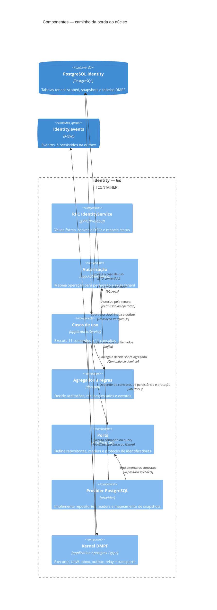

# Componentes internos — identity

Cada chamada percorre as camadas do app; nos comandos, o kernel DMPF coordena a transação e a idempotência. Consultas leem pelo pool de leitura, sem UoW.

## Caminho de execução

1. O servidor RPC valida o formato da requisição; a validação de negócio permanece no domínio.
2. A aplicação autoriza a operação pelo tenant no contexto de execução. A permissão do usuário é resolvida pelo BFF chamador por `FindEffectivePermissions`; o interceptor gRPC deste contexto não monta o sujeito do usuário.
3. Para comandos, `Execute` abre UoW, verifica a inbox pelo consumer `identity.commands` e fingerprint, então chama o caso de uso; `Decide` carrega o agregado, aplica a regra, salva com controle de versão e enfileira eventos na mesma transação.
4. Recusa de domínio é resultado de negócio persistido pela idempotência, sem salvar estado ou evento. Erros operacionais retornam como erro/status gRPC.
5. Consultas usam `Query`/`findRelated`, autorizam e leem pelos readers sem abrir UoW.
6. Readers/repositorios usam `provider`; a proteção HMAC é aplicada pela aplicação antes de lookups/criações de identificadores.

Os detalhes por operação estão nas [22 sequências](./sequences/README.md); as jornadas que compõem mais de uma RPC estão em [journeys](./journeys/README.md).
