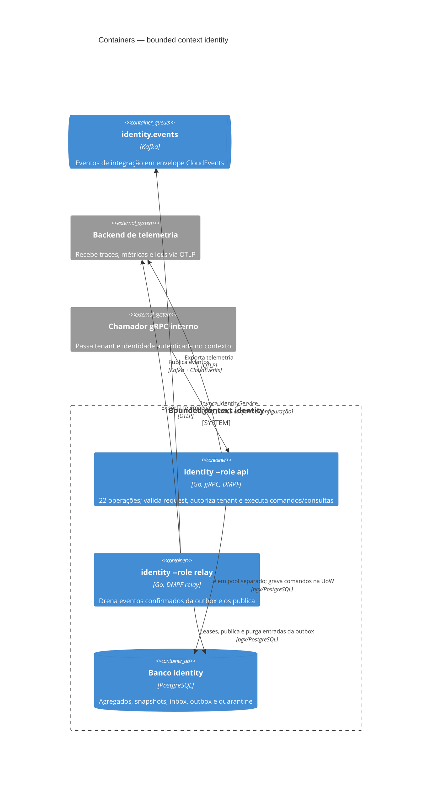

# Containers e processos — identity

`cmd/identity` é um único binário Go executado em papéis separados com `--role`. `api` e `relay` não compartilham processo; o PostgreSQL é o ponto de integração durável entre eles.

## Papéis e armazenamento

- `api`: serve gRPC, aplica migrações se `MIGRATE=true` e purga entradas vencidas da inbox. Usa pools distintos para transações e consultas consultivas/reads.
- `relay`: lê a outbox no mesmo banco, publica `identity.events` e purga eventos publicados após a retenção. Não consome canal.
- O schema é híbrido: colunas tipadas para filtros/índices e `snapshot` JSONB para o restante do agregado. O [ERD](./data-model.md) mostra as tabelas do contexto.
- `inbox`, `outbox` e `quarantine` são estruturas do kernel DMPF. A gravação do estado e a entrada na outbox pertencem à mesma transação.
- A chave HMAC é exigida pelo `api`; credenciais do Kafka são exigidas pelo `relay`. A chave de identificador não é compartilhada com o relay.
