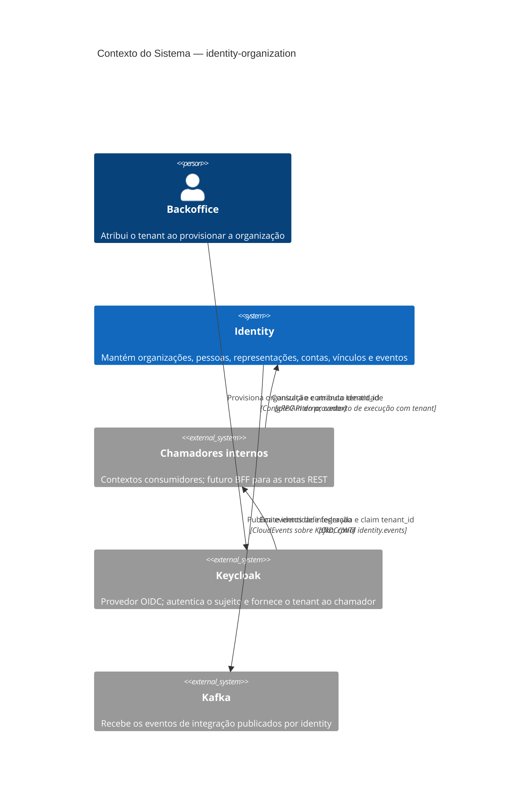

# Contexto do sistema — identity

Este diagrama mostra `identity` como serviço interno. O BFF REST é uma borda prevista, mas não implementada neste workspace; o sistema não acessa Keycloak diretamente.

## Limites

- **Implementado:** serviço gRPC; o contexto isola leituras e escritas por tenant e publica os eventos descritos em [eventos](./journeys/outbox-relay.md).
- **Implementado:** outros contextos consomem identidade e organização por gRPC; `identity` não consome eventos.
- **Futuro/fora do escopo:** o BFF e a borda REST indicada pelo OpenAPI. O relacionamento com Keycloak é parte da federação/provisionamento da identidade no chamador; `identity` não faz chamada OIDC direta.
- **Armazenamento e runtime:** detalhados em [containers](./c4-containers.md).
