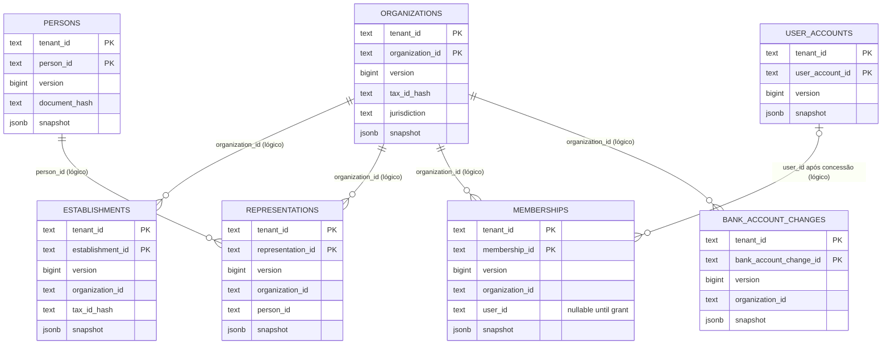

# Modelo de dados — identity

O banco é próprio do contexto. As chaves primárias são compostas por `tenant_id` e o ID do agregado. Colunas tipadas existem para filtros e índices; os demais atributos ficam no `snapshot` JSONB.

> As relações do diagrama são referências lógicas por ID no estado do domínio. O DDL não declara foreign keys entre essas tabelas.

## Dados e isolamento

- **Tenant:** inicia a chave primária e participa das unicidades. A consulta de um ID pertencente a outro tenant é tratada como inexistente para o chamador; tentativas de acesso cruzado são registradas pelo kernel.
- **Unicidade:** organizações por `(tenant_id, tax_id_hash, jurisdiction)`; estabelecimentos por `(tenant_id, organization_id, tax_id_hash)`; pessoas por `(tenant_id, document_hash)`.
- **PII:** CNPJ/identificador fiscal de organização e estabelecimento permanece em claro no snapshot nesta versão; pessoa armazena hash HMAC-SHA256, máscara e versão da chave, nunca o documento. A troca bancária guarda somente o ID da evidência de destino, não os dados bancários.
- **Snapshots:** os campos completos podem ser consultados em [schema.sql](../../provider/schema.sql) e nos tipos de snapshot do [domínio](../../domain/).
- **Infra do kernel:** `inbox`, `outbox` e `quarantine` são tabelas geridas pelo kernel DMPF; não estão declaradas no schema local e por isso não são expandidas neste ERD. O fluxo da outbox está em [jornada de publicação](./journeys/outbox-relay.md).
