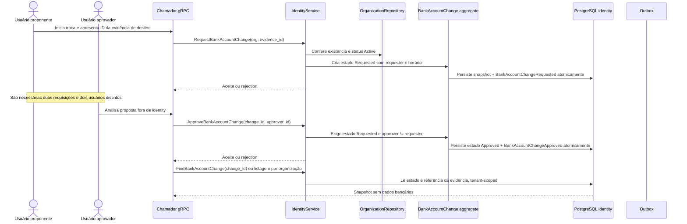

# Jornada — dupla aprovação bancária

A alteração bancária é representada neste contexto pela referência à evidência do destino. Os dados bancários pertencem a outro contexto e não são recebidos nem persistidos por `identity`.

**Não implementado:** rejeitar/cancelar proposta, notificar aprovador ou efetivar os dados no destino. A aprovação não é automática e não altera o armazenamento bancário de outro contexto.
