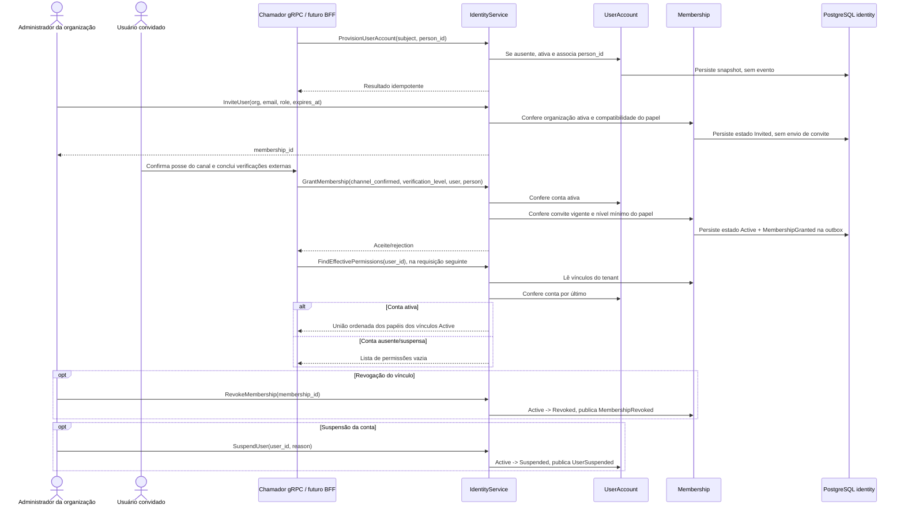

# Jornada — provisionamento, vínculo e permissões

A conta autenticável, o convite para uma organização e o vínculo ativo são operações distintas. `identity` não envia e-mail, confirma canal nem consulta serviço de verificação; as confirmações chegam como dados de `GrantMembership`.

## Etapas e fronteiras

1. `ProvisionUserAccount` inicializa por `subject` do provedor federado; conta existente é aceita sem novo efeito de domínio.
2. `InviteUser` persiste o estado `Invited`; não dispara e-mail nem espera callback dentro da mesma chamada.
3. Confirmação de canal e verificação documental/liveness são passos externos. O grant valida apenas os valores recebidos e a conta ativa.
4. `FindEffectivePermissions` agrega papéis somente de memberships `Active` e retorna vazio se a conta não existe ou está suspensa.
5. Revogação e suspensão são comandos independentes. As permissões são consultadas novamente; não há saga ou cache de permissão em `identity`.

O BFF que faria a consulta a cada requisição é futuro/não está presente neste workspace. Ver [as sequências individuais](../sequences/README.md).
