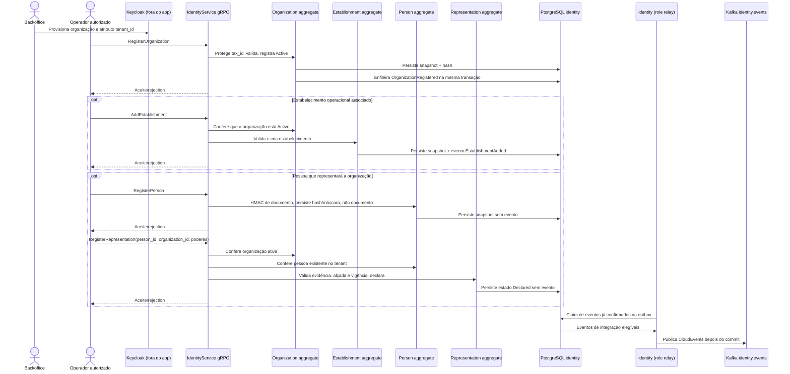

# Jornada — organização e cadastros relacionados

O tenant é provisionado pelo backoffice no provedor de identidade; as operações seguintes são chamadas explícitas, não uma saga disparada automaticamente pelo registro da organização.

## Limites da jornada

- `RegisterOrganization` não cria automaticamente estabelecimentos, pessoas, representações, usuários ou vínculos.
- `AddEstablishment` e `RegisterRepresentation` fazem precondições explícitas sobre organização ativa; representação também exige pessoa existente.
- `RegisterPerson` e `RegisterRepresentation` não publicam eventos de integração nesta versão.
- O documento de pessoa nunca é persistido. O hash do identificador fiscal e do documento é tenant-scoped.
- O cadastro/gestão do Keycloak e o BFF não são componentes implementados pelo app.
