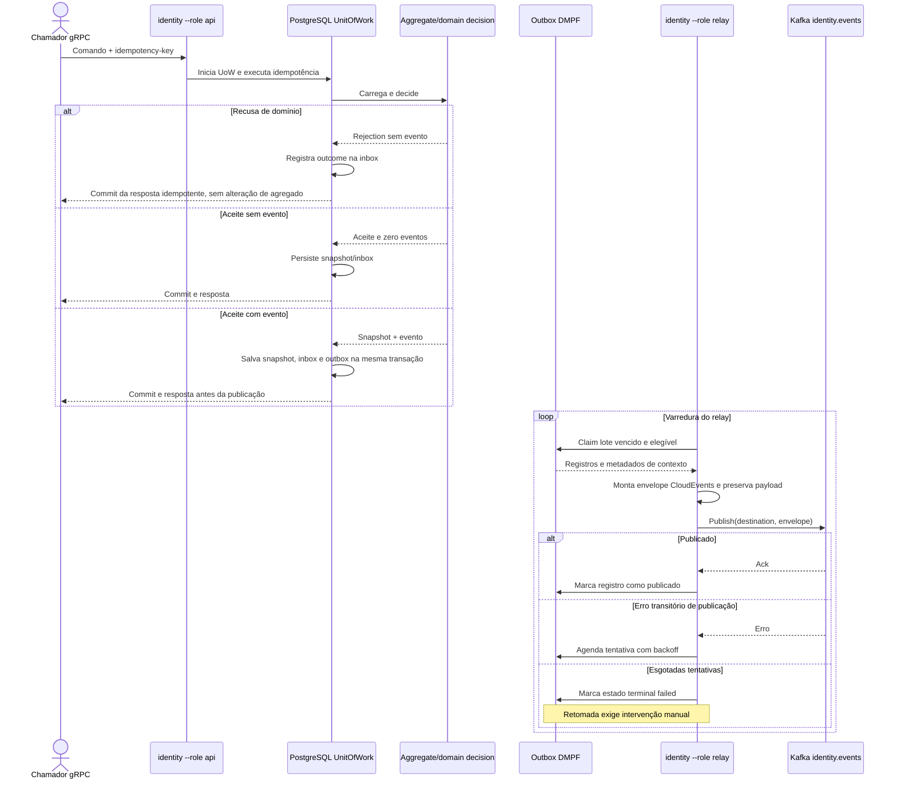

# Jornada — commit transacional e publicação pela outbox

Somente os comandos que produzem um evento de domínio escrevem uma entrada de outbox. O relay publica após o commit; não há consumer identity nem saga.

## Política operacional

- O commit do comando e a gravação na outbox são atômicos; uma recusa de domínio não grava agregado nem evento.
- A tentativa de publicação acontece em outro processo, selecionado por `--role relay`.
- Configuração atual: até 24 tentativas; backoff exponencial de 200 ms até 5 min; retenção de 168 h para eventos publicados; purga em lotes de 1000 a cada 15 min.
- Falha do broker também conta como tentativa. Após o estado terminal `failed`, a operação exige retomada manual.
- O relay serializa o envelope CloudEvents e publica no tópico configurado `identity.events`; o contexto não consome o tópico nem dispara saga.
