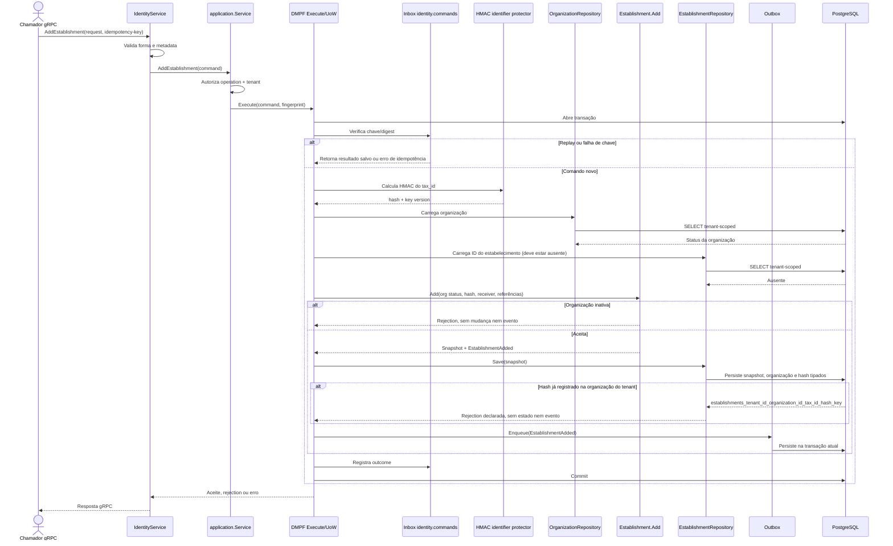

# AddEstablishment

Comando que acrescenta estabelecimento a organização ativa. Rota OpenAPI destinada ao futuro BFF: `POST /identity/organizations/{organizationId}/establishments`.

**Efeito/evento:** persiste hash, máscara e metadados; `EstablishmentAdded` é enfileirado atomicamente com a mudança. O CNPJ pode continuar no snapshot em claro nesta versão.
