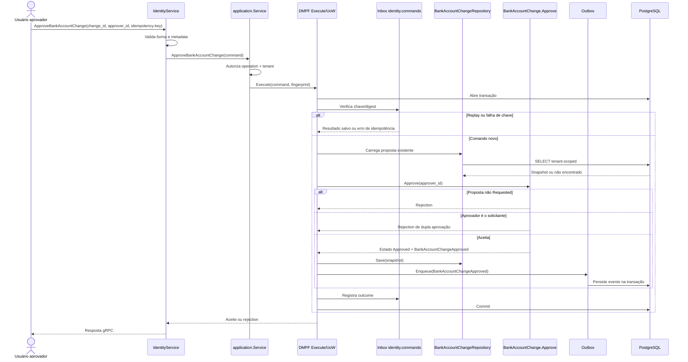

# ApproveBankAccountChange

Comando que aprova uma proposta ainda pendente por usuário diferente do solicitante. Rota OpenAPI destinada ao futuro BFF: `POST /identity/bank-account-changes/{bankAccountChangeId}/approve`.

**Efeito/evento:** aprovação não move os dados bancários; consolida a decisão e publica `BankAccountChangeApproved`. Não há operação de rejeição/cancelamento implementada neste contexto.
