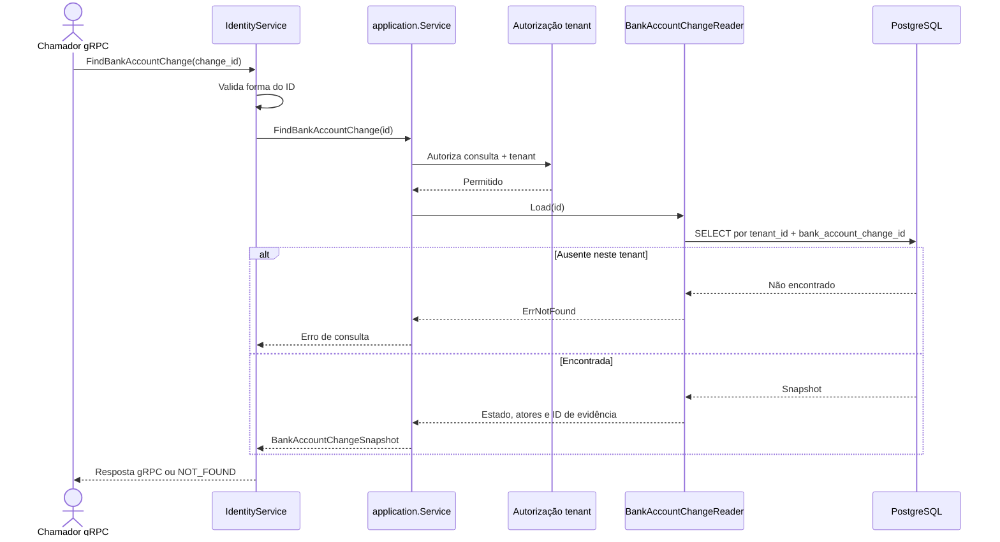

# FindBankAccountChange

Consulta de uma solicitação de troca bancária por ID. Rota OpenAPI destinada ao futuro BFF: `GET /identity/bank-account-changes/{bankAccountChangeId}`.

O snapshot não contém os dados bancários do destino.
