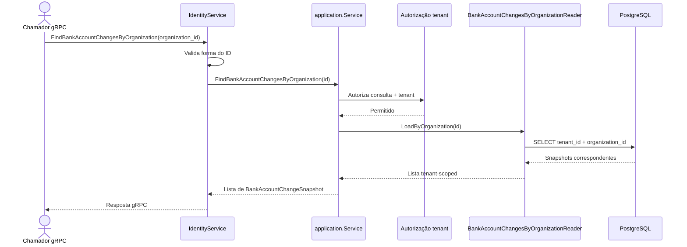

# FindBankAccountChangesByOrganization

Consulta as solicitações de troca bancária de uma organização. Rota OpenAPI destinada ao futuro BFF: `GET /identity/organizations/{organizationId}/bank-account-changes`.

Read-only: sem UoW, metadata de idempotência ou evento.
