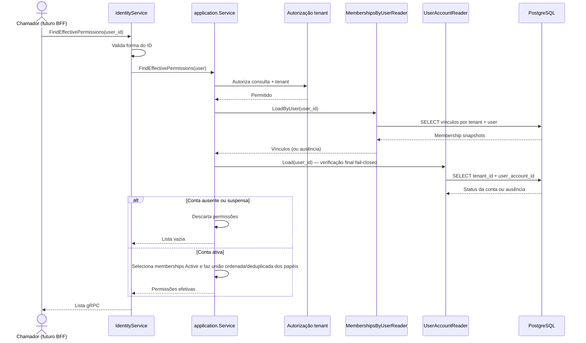

# FindEffectivePermissions

Resolve permissões atuais pela união ordenada dos papéis de vínculos ativos, somente se a conta estiver ativa. Rota OpenAPI destinada ao futuro BFF: `GET /identity/users/{userId}/permissions`.

As leituras não compartilham snapshot transacional. Por isso a conta é verificada por último: uma suspensão concorrente esvazia a resposta. A leitura de permissões não é cacheada no desenho desta versão; o BFF é futuro.
