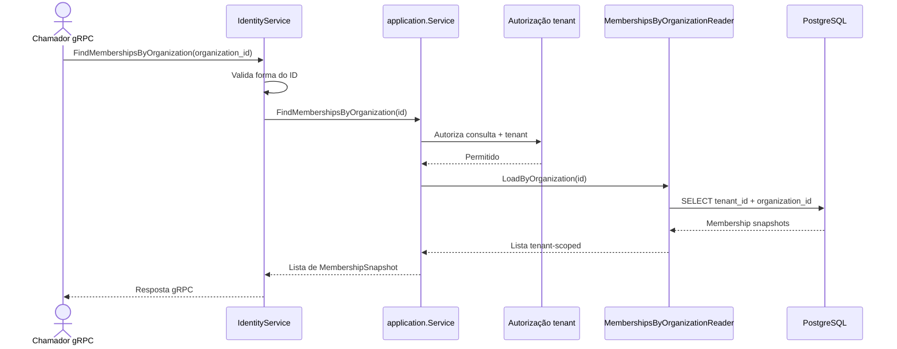

# FindMembershipsByOrganization

Consulta os vínculos de uma organização. Rota OpenAPI destinada ao futuro BFF: `GET /identity/organizations/{organizationId}/memberships`.

Read-only: sem UoW, metadata de idempotência ou evento.
