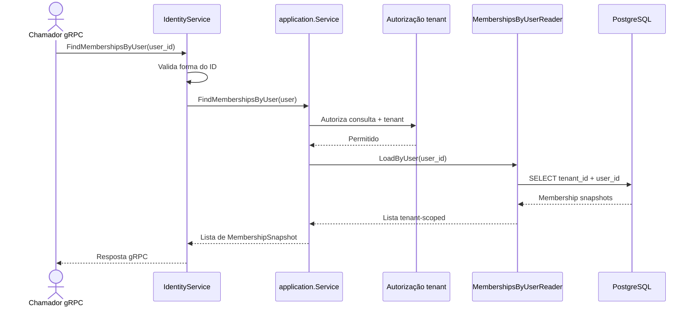

# FindMembershipsByUser

Consulta os vínculos de um usuário no tenant corrente. Rota OpenAPI destinada ao futuro BFF: `GET /identity/users/{userId}/memberships`.

Read-only: sem UoW, metadata de idempotência ou evento.
