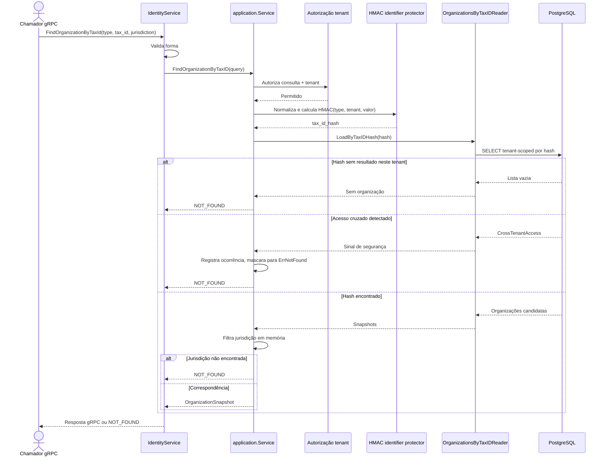

# FindOrganizationByTaxId

Consulta por identificador fiscal protegido, com filtro final de jurisdição. Rota OpenAPI destinada ao futuro BFF: `POST /identity/organization-lookups`.

**Privacidade:** o valor fiscal original não é usado como chave da consulta; o hash inclui tenant e tipo do identificador. A resposta não revela que um identificador pertence a outro tenant.
