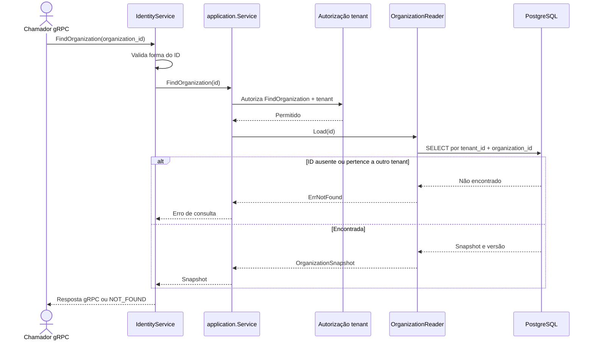

# FindOrganization

Consulta de organização por ID. Rota OpenAPI destinada ao futuro BFF: `GET /identity/organizations/{organizationId}`.

Consulta read-only: sem `idempotency-key`, UoW ou evento. A resposta é tenant-scoped.
