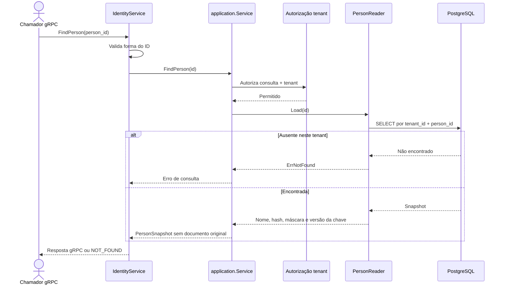

# FindPerson

Consulta de pessoa por ID. Rota OpenAPI destinada ao futuro BFF: `GET /identity/persons/{personId}`.

Read-only: sem UoW, metadata de idempotência ou evento. O documento original não é armazenado.
