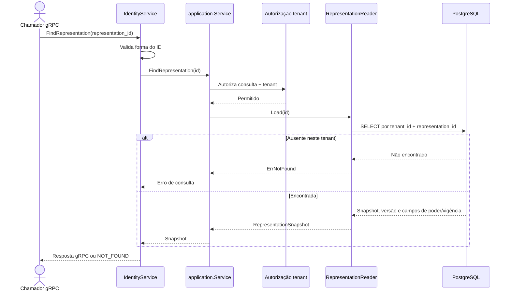

# FindRepresentation

Consulta de representação por ID. Rota OpenAPI destinada ao futuro BFF: `GET /identity/representations/{representationId}`.

Read-only: sem UoW, metadata de idempotência ou evento.
