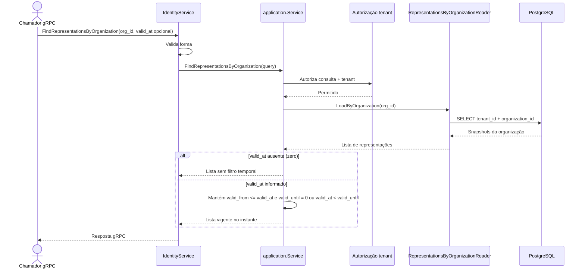

# FindRepresentationsByOrganization

Consulta as representações de uma organização, opcionalmente filtradas pela vigência em um instante. Rota OpenAPI destinada ao futuro BFF: `GET /identity/organizations/{organizationId}/representations`.

Read-only: a validade é refinada em memória sobre o resultado do reader; não altera estado ou gera evento.
