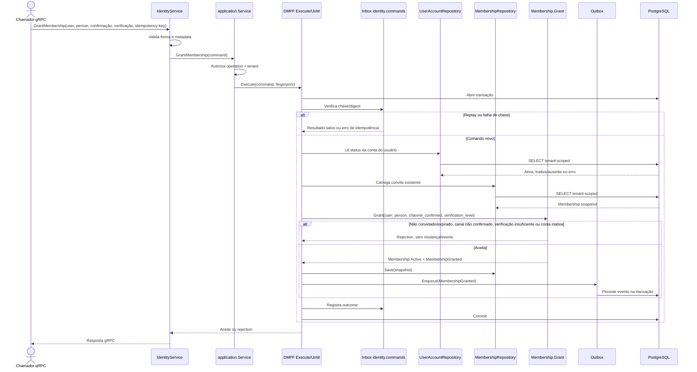

# GrantMembership

Comando que transforma um convite válido em vínculo ativo. Rota OpenAPI destinada ao futuro BFF: `POST /identity/memberships/{membershipId}/grant`.

**Efeito/evento:** canal confirmado e nível de verificação são dados do comando; o app não confirma e-mail nem consulta verificador documental. A concessão publica `MembershipGranted`.
