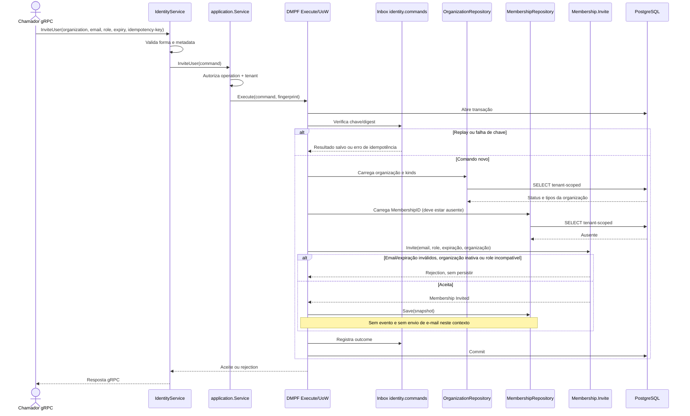

# InviteUser

Comando que cria um vínculo em estado `Invited`. Rota OpenAPI destinada ao futuro BFF: `POST /identity/organizations/{organizationId}/memberships`.

**Efeito/evento:** cria o convite persistido, mas não envia comunicação. Confirmação do canal e nível de verificação são pré-condições fornecidas depois a `GrantMembership`, não chamadas a um provedor externo por este caso de uso.
