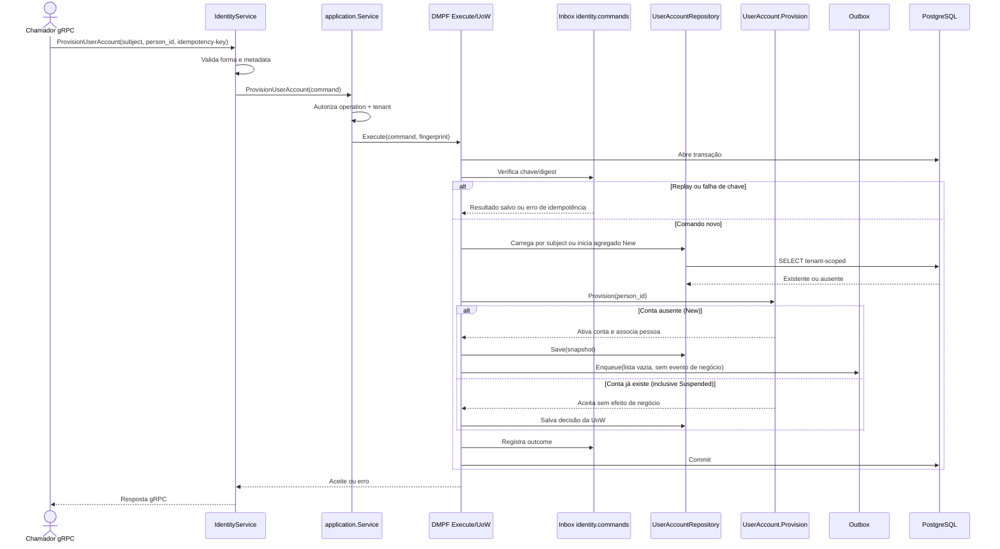

# ProvisionUserAccount

Comando que provisiona a conta correspondente ao `sub` federado. Rota OpenAPI destinada ao futuro BFF: `POST /identity/users`.

**Efeito/evento:** a primeira provisão torna a conta `Active`; uma conta já existente, inclusive suspensa, é aceita sem evento. A existência de conta não é autorização de sessão: a consulta de permissões continua verificando status.
