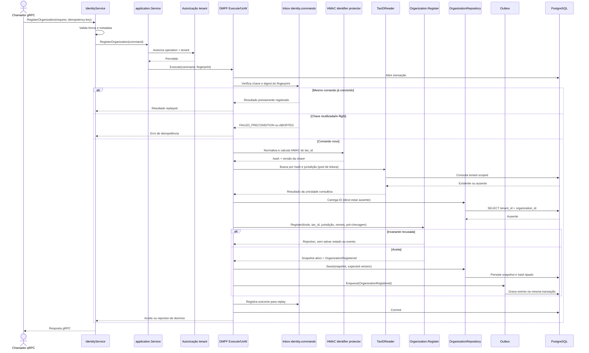

# RegisterOrganization

Comando para criar uma organização no tenant da requisição. Rota OpenAPI destinada ao futuro BFF: `POST /identity/organizations`.

**Efeito/evento:** cria estado `Active`; publica `OrganizationRegistered` via outbox. O evento leva hash e máscara, não o identificador em claro. A consulta consultiva não substitui a unicidade do índice PostgreSQL em corridas.
