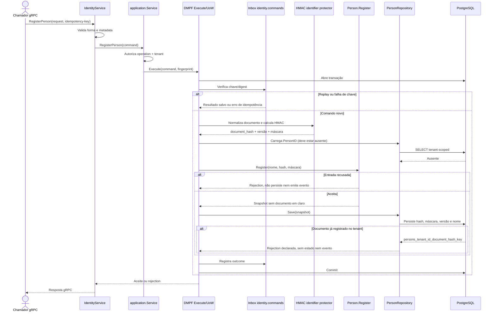

# RegisterPerson

Comando que registra uma pessoa natural sem persistir o documento original. Rota OpenAPI destinada ao futuro BFF: `POST /identity/persons`.

**Efeito/evento:** nenhum evento de integração é publicado por `RegisterPerson`. O documento aparece no fingerprint apenas transitoriamente; a inbox guarda o digest HMAC do fingerprint, não o fingerprint em claro.
