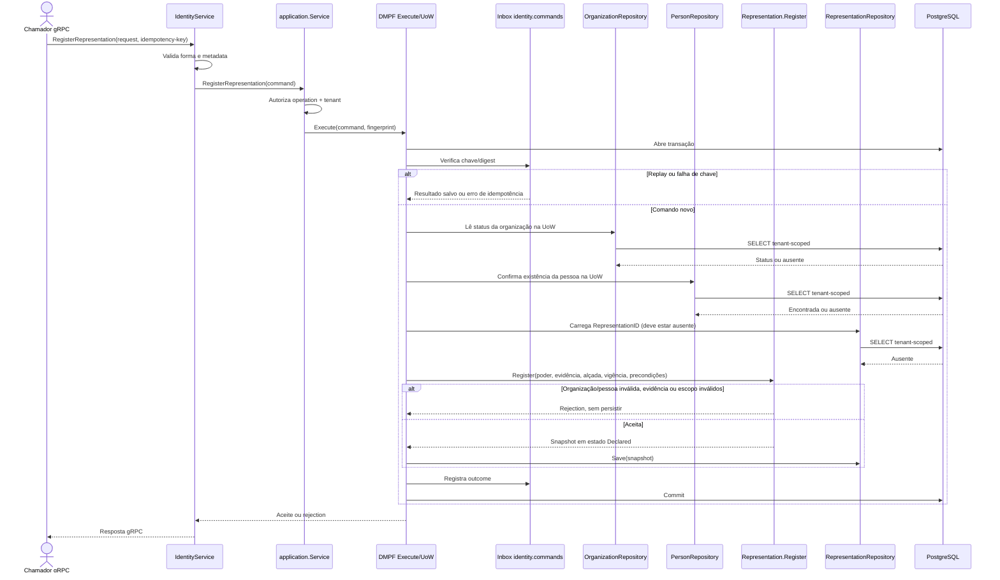

# RegisterRepresentation

Comando que declara poderes de uma pessoa para uma organização. Rota OpenAPI destinada ao futuro BFF: `POST /identity/organizations/{organizationId}/representations`.

**Efeito/evento:** não publica evento. A representação inicia `Declared`; não há neste contexto operações de verificação/revogação nem transição para outro estado.
