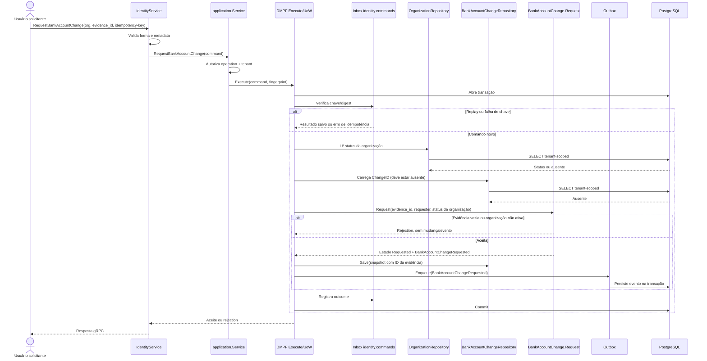

# RequestBankAccountChange

Comando que registra uma proposta de troca da conta bancária. Rota OpenAPI destinada ao futuro BFF: `POST /identity/organizations/{organizationId}/bank-account-changes`.

**Efeito/evento:** só o ID da evidência do destino é armazenado; dados bancários não entram neste contexto. A aprovação é um segundo comando e deve vir de outro usuário.
