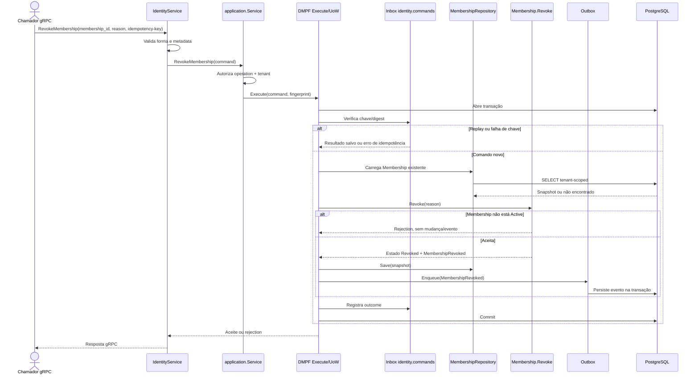

# RevokeMembership

Comando que revoga um vínculo ativo. Rota OpenAPI destinada ao futuro BFF: `POST /identity/memberships/{membershipId}/revoke`.

**Efeito/evento:** vínculo passa de `Active` a `Revoked`; permissões efetivas são recalculadas nas próximas consultas, sem cache no desenho da spec.
