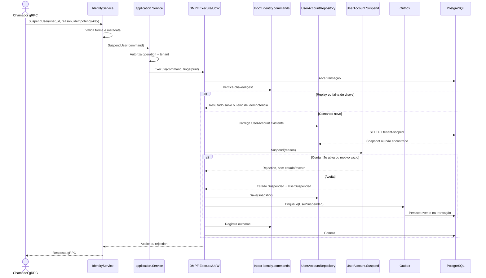

# SuspendUser

Comando que suspende uma conta ativa. Rota OpenAPI destinada ao futuro BFF: `POST /identity/users/{userId}/suspend`.

**Efeito/evento:** suspensão é terminal no conjunto de operações atual: não existe reativação. `FindEffectivePermissions` falha fechado para conta suspensa.
