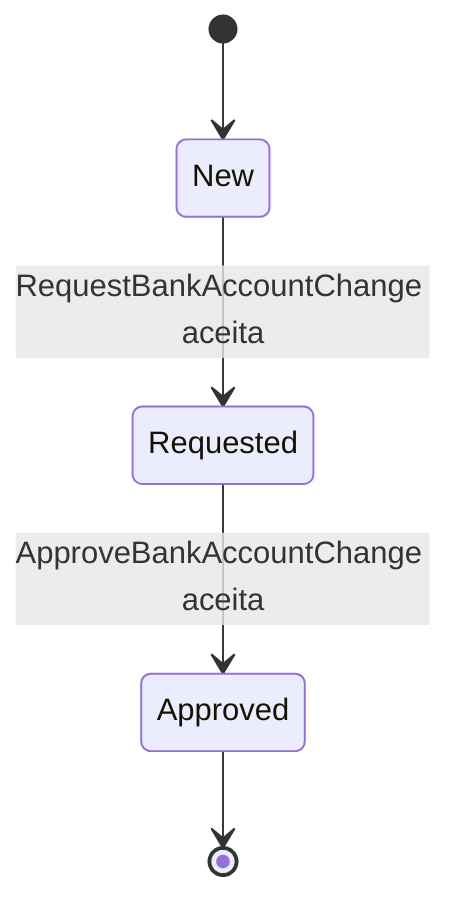

# Estados — BankAccountChange

A aprovação só é válida quando o estado é `Requested` e o aprovador difere do solicitante. Não há estados nem operações de rejeição, cancelamento, expiração ou alteração posterior implementados.
