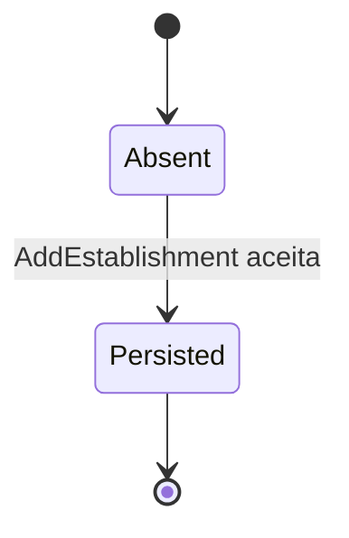

# Ciclo de vida — Establishment

`Establishment` não possui campo de status no agregado. O diagrama representa somente ausência/criação persistida; não há operação de atualização, suspensão ou remoção neste contexto.
