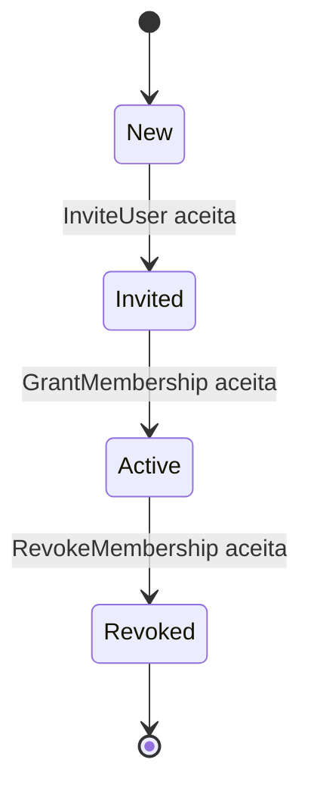

# Estados — Membership

`GrantMembership` exige convite ainda não expirado, canal confirmado, nível de verificação suficiente para o papel e conta de usuário ativa. Convite expirado não vira estado `Expired`: a tentativa é recusada, sem transição automática. `Revoked` não tem reativação.
