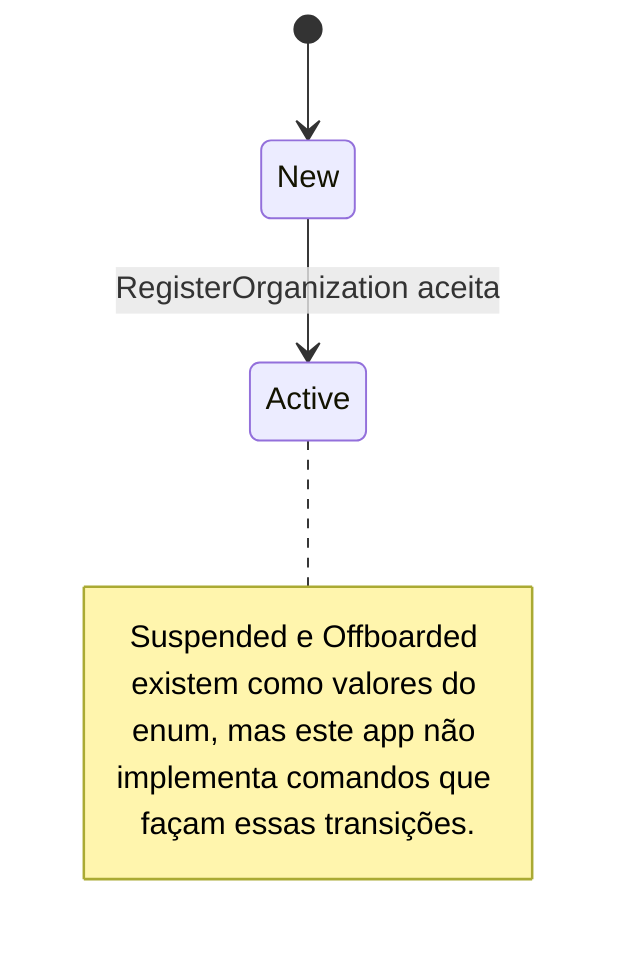

# Estados — Organization

A organização precisa estar `Active` para inclusão de estabelecimento, representação, convite e solicitação de troca bancária. O caso de uso de registro é a única transição de status atualmente implementada.
