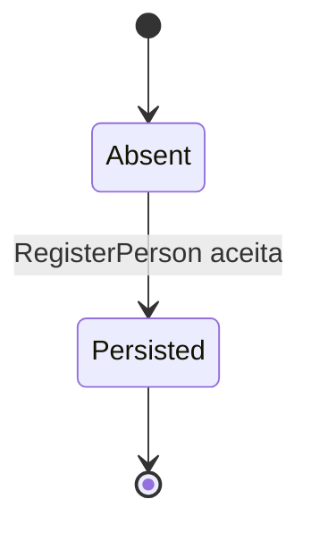

# Ciclo de vida — Person

`Person` não possui campo de status nem comando de atualização/remoção. O documento original não é parte do estado persistido: ficam hash HMAC, máscara, versão da chave e nome.
