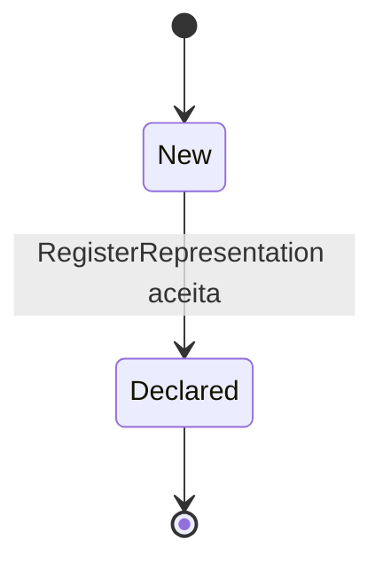

# Estados — Representation

`New` e `Declared` são os valores modelados em `RepresentationStatus`. A verificação externa, a revogação/substituição e as respectivas transições não são operações implementadas por `identity`. A validade temporal é uma comparação derivada, não um estado persistido.
