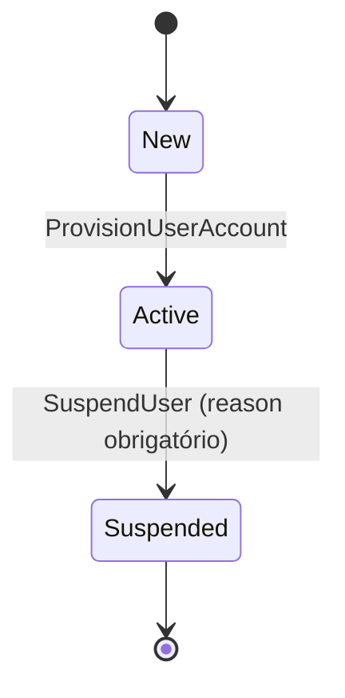

# Estados — UserAccount

O comando de provisão inicializa apenas uma conta ausente. Uma conta existente — mesmo `Suspended` — é aceita sem efeito de domínio. A suspensão exige conta `Active`; não existe reativação implementada.
